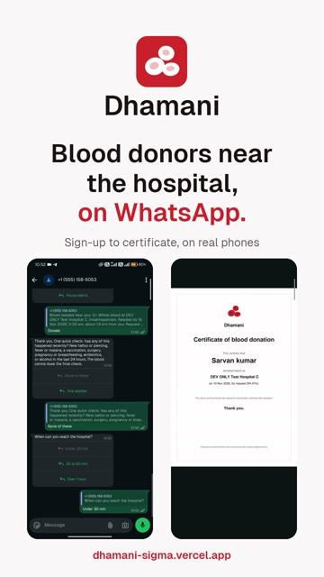
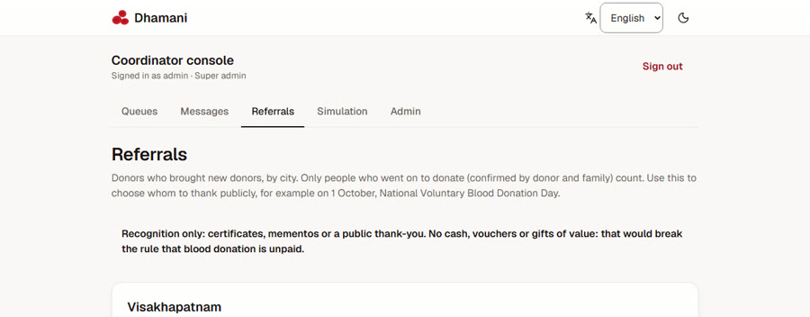
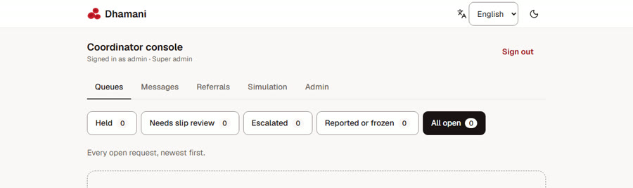
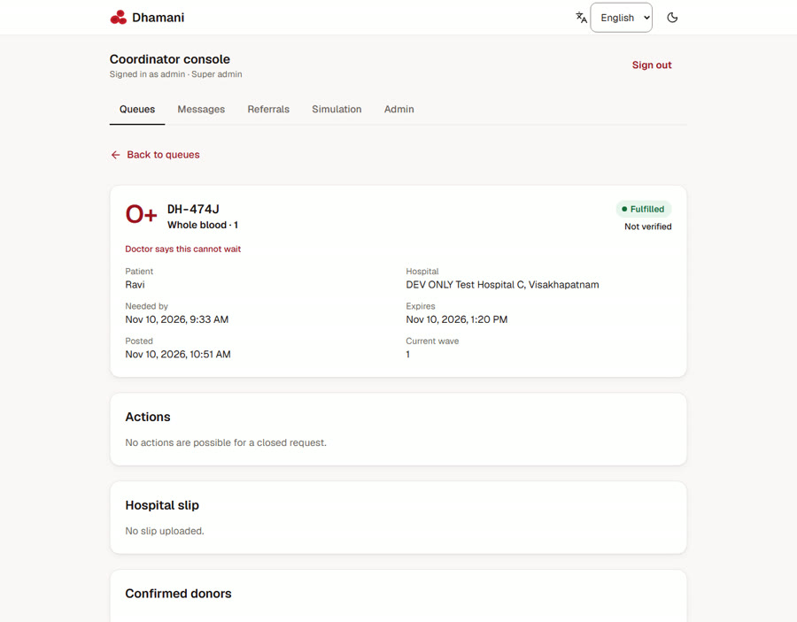
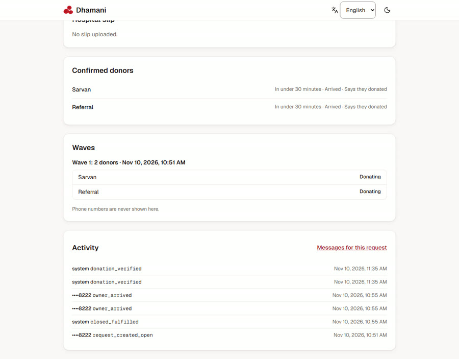
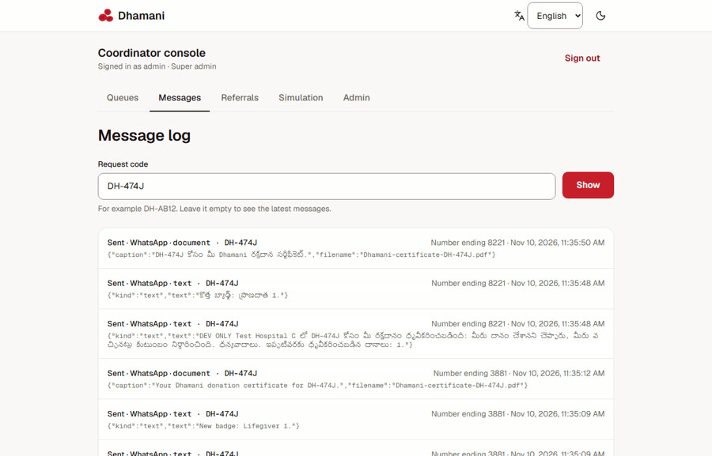
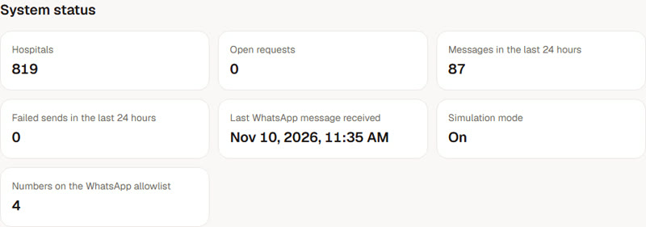
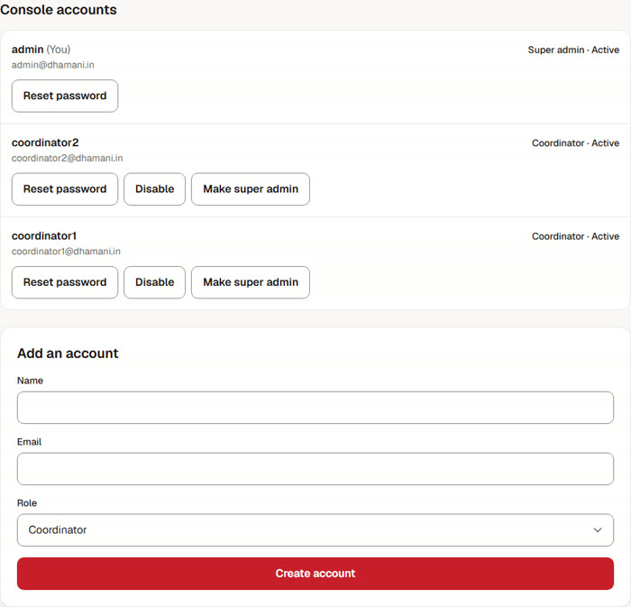
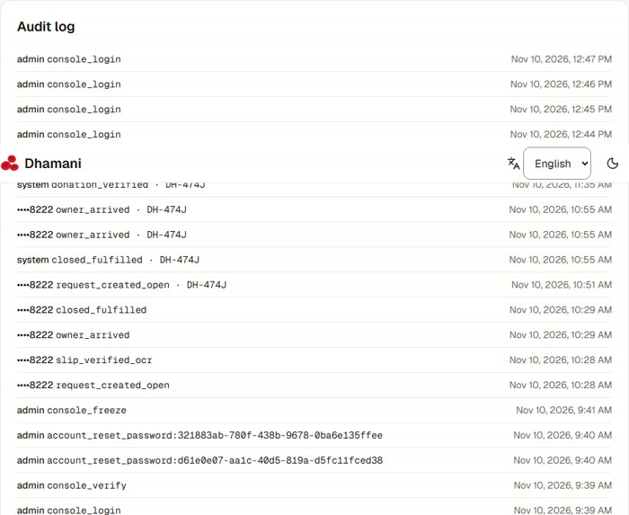
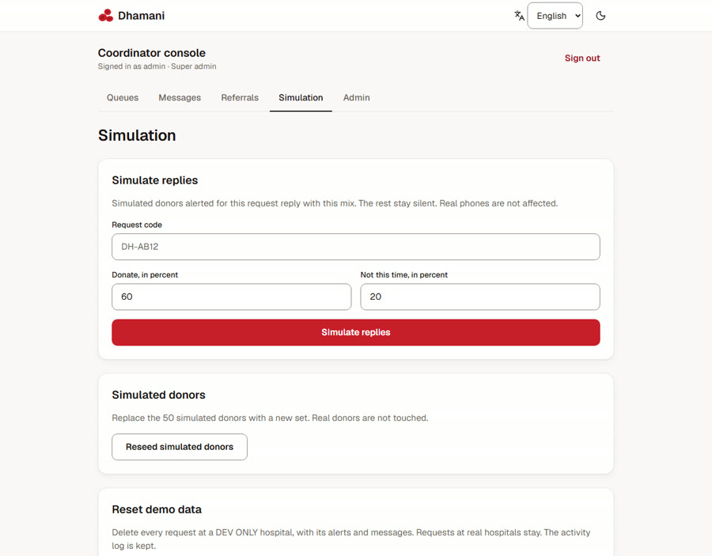

<p align="center">
  
</p>

<p align="center">
  <strong>Families ask for blood on the web. Nearby, compatible donors answer on WhatsApp.</strong><br>
  <a href="https://dhamani-sigma.vercel.app">dhamani-sigma.vercel.app</a>
</p>

<p align="center">
  <a href="https://youtube.com/shorts/0sk_xS1oKW0">
    
  </a><br>
  <a href="https://youtube.com/shorts/0sk_xS1oKW0"><b>Watch the demo</b></a> · 2:45, sign-up to certificate on real phones
</p>

---

When someone in hospital needs blood, the family usually starts calling everyone they know. Dhamani replaces that scramble with one request. It finds voluntary donors near the hospital whose blood group fits, asks them on WhatsApp, and shows the family who is coming, live.

Dhamani only pre-screens donors. It never declares anyone fit to donate; the blood centre always decides.

## Why Dhamani

- **WhatsApp first, nothing to install.** Donors sign up by sending `JOIN`, answer a few questions, and get alerts where they already chat. Families sign in by sending a short code from their own WhatsApp: no password, no SMS.
- **Only the right donors are asked.** Alerts go to donors with a compatible blood group who are near the hospital and past their donation interval, in waves, so nobody gets spammed.
- **Private by design.** Donor phone numbers are never shown to families or the public. Patients appear by first name and initial only.
- **Speaks your language.** English, Tamil and Telugu, on the web and on WhatsApp.
- **Voluntary, always.** No payments, rewards or leaderboards. Thanks come as certificates and badges.

## How it works

<p align="center">
  
</p>

**See every screen:** [step-by-step walkthrough with screenshots](docs/WALKTHROUGH.md)

<table>
  <tr>
    <td align="center" width="50%">
      <br>
      <sub>A family signs in with one WhatsApp message.</sub>
    </td>
    <td align="center" width="50%">
      <br>
      <sub>Donor and family both confirm, and the certificate arrives.</sub>
    </td>
  </tr>
</table>

## Features

- **Live request page.** The family posts a request (blood group, hospital, when it is needed) and follows it on a page that updates every few seconds: who said yes, when they expect to arrive, who has arrived.
- **Donate in three taps.** A donor taps Donate, answers a quick health check, and picks an arrival time. Answers to the check are never stored.
- **Verified donations.** A donation counts once the donor says they donated and the family marks them as arrived.
- **Certificates and Lifegiver badges.** Each verified donation earns a PDF certificate and badges, on the donor's private page (a 24 hour link sent on WhatsApp).
- **Invite links and recognition.** Every donor has a personal invite link. Donors who bring new donors can be thanked publicly, with their consent. See [Referral recognition](#referral-recognition).
- **Coordinator console.** A web console for the people who keep requests honest and moving. See [Coordinators and super admin](#coordinators-and-super-admin).
- **Reminders that respect people.** Requests close themselves when they expire. Donors hear "you can donate again" only once their interval has passed.
- **Installable.** Works as a PWA on any phone.

## Referral recognition

Most donors join because someone they know asked them. Dhamani makes that easy to do and fair to recognise.

1. **Share a link.** Sending `STATUS` on WhatsApp returns the donor's private page and a personal invite link. The link opens WhatsApp with `JOIN` and the donor's code ready to send.
2. **A friend joins.** The friend signs up with the same short chat, in their own language. The donor's page shows how many people joined with their link.
3. **It counts after a real donation.** A referral counts only once the friend has a verified donation, confirmed by both the friend and the family. Sign-ups alone do not count, so the numbers cannot be padded.
4. **Top referrers per city.** Coordinators see who brought the most donors in each city: first name, nearest city and counts only.
5. **Ask before naming anyone.** "Ask to thank publicly" sends the donor a WhatsApp question with Yes and No. Nobody is named without a yes.
6. **The award.** A certificate, a memento or a public thank-you, for example on 1 October, National Voluntary Blood Donation Day.

<p align="center">
  <br>
  <sub>Console, Referrals: a donor who brought one new donor, who then donated. Not asked yet.</sub>
</p>

> Blood donation in India is voluntary and unpaid. Dhamani never attaches cash, vouchers or gifts of value to donations or referrals: recognition only.

## Coordinators and super admin

Coordinators sign in at `/console/login` with an email and password. There is no public sign-up: accounts come from the seed or are created by a super admin. Sessions last 12 hours, and repeated failed logins lock the account for a while.

**Coordinators can:**

| Area | What it does |
|---|---|
| **Queues** | Held (requests that mention money), Needs slip review, Escalated (all alert waves sent, still short of donors), Reported or frozen, All open. Each tab shows a count. |
| **Request detail** | The slip photo, the facts of the request, each alert wave with every donor's reply, confirmed donors and an activity log. |
| **Actions** | Release a hold, approve a slip, mark verified after a phone call, freeze or unfreeze, cancel. Risky actions ask for confirmation, and every action is recorded. |
| **Messages** | Every WhatsApp message, real or simulated, filterable by request code. Numbers show only their last 4 digits. |
| **Referrals** | Top referrers per city and the "Ask to thank publicly" button. |
| **Simulation** | For demos only: simulated donors reply with a chosen mix, through the same code as real phones. |

**A super admin can also:**

| Area | What it does |
|---|---|
| **System status** | Hospitals, open requests, messages and failed sends in the last 24 hours, the last WhatsApp message received, simulation mode, allowlist size. |
| **Accounts** | Add a coordinator or super admin with a one-time password, disable or enable, reset a password, change a role. A super admin cannot disable or demote themselves. |
| **Hospitals** | Search the blood centre list by name or city. |
| **Audit log** | Every console action and system event, newest first. |

Neither role ever sees a list of all donors or a donor's phone number. Donors appear only on the requests they were alerted for, by first name, and every console read runs through a read-only database role.

**Coordinator screens**

<table>
  <tr>
    <td align="center" width="50%"><br><sub>Queues, with a count on every tab</sub></td>
    <td align="center" width="50%"><br><sub>Request detail: facts, status, actions, slip</sub></td>
  </tr>
  <tr>
    <td align="center"><br><sub>Confirmed donors, alert waves and replies, activity</sub></td>
    <td align="center"><br><sub>Message log by request code, numbers masked</sub></td>
  </tr>
</table>

**Super admin screens**

<table>
  <tr>
    <td align="center" width="50%"><br><sub>System status</sub></td>
    <td align="center" width="50%"><br><sub>Accounts: add, disable, reset password, change role</sub></td>
  </tr>
  <tr>
    <td align="center"><br><sub>Audit log</sub></td>
    <td align="center"><br><sub>Simulation panel for demos</sub></td>
  </tr>
</table>

## Tech stack

| Area | Choice |
| --- | --- |
| App | Next.js 15 App Router, React 19, TypeScript strict |
| UI | Tailwind v4, shadcn/ui, lucide-react |
| Languages | next-intl (English, Tamil, Telugu), time zone Asia/Kolkata |
| Data | Neon Postgres with PostGIS, `@neondatabase/serverless`, row level security |
| Messaging | WhatsApp Cloud API through a single adapter |
| Certificates | pdf-lib |
| Slip OCR | tesseract.js, in the browser |
| Validation and tests | zod, Vitest |
| Hosting | Vercel (functions in `sin1`, next to the database), cron-job.org for scheduled jobs |

Hospitals come from the Government of India Blood Bank Directory on data.gov.in (Andhra Pradesh, Telangana, Tamil Nadu, Kerala, Karnataka). See `db/seed/hospitals.SOURCE.md`.

## Run locally

Needs Node 22 or newer.

```bash
npm install
cp .env.example .env.local   # then fill in values
npm run db:migrate
npm run db:seed
npm run dev                   # http://localhost:3000
```

Environment variables (server side only; never use the `NEXT_PUBLIC_` prefix for secrets):

| Variable | Purpose |
| --- | --- |
| `DATABASE_URL` | Neon pooled connection string |
| `APP_BASE_URL` | Public base URL for links and metadata |
| `SESSION_SECRET` | Signs session cookies and donor page tokens |
| `CRON_SECRET` | Bearer token for the cron routes |
| `WA_PHONE_NUMBER_ID`, `WA_ACCESS_TOKEN`, `WA_APP_SECRET`, `WA_VERIFY_TOKEN`, `WA_BUSINESS_NUMBER` | WhatsApp Cloud API |
| `WA_ALLOWLIST` | Numbers allowed to receive messages (max 5; empty means nobody) |
| `WA_GRAPH_VERSION` | Graph API version, default `v23.0` |
| `SIMULATION_MODE` | `true` enables the console simulation page |
| `COORDINATOR_EMAILS`, `SUPER_ADMIN_EMAILS` | Console accounts created by the seed |
| `DATA_GOV_IN_API_KEY` | Only for `db:import-hospitals` |

## Scripts

| Script | What it does |
| --- | --- |
| `npm run dev` | Dev server |
| `npm run build` | Production build, then a check that no secrets reach the client bundle |
| `npm start` | Serve the build |
| `npm run lint` / `npm run typecheck` | ESLint / `tsc --noEmit` |
| `npm test` | Unit tests |
| `npm run test:db` | Database and RLS tests against the real database |
| `npm run db:migrate` | Apply new SQL migrations |
| `npm run db:reset -- --yes` | Drop everything and re-migrate. Destructive. |
| `npm run db:seed` | Seed hospitals and console accounts |
| `npm run db:import-hospitals` | Regenerate `db/seed/hospitals.csv` from data.gov.in |
| `npm run templates:md` | Regenerate `TEMPLATES.md` from the WhatsApp copy |

## Testing

```bash
npm run lint && npm run typecheck && npm test && npm run build
```

`npm run test:db` uses synthetic numbers starting `910000000`. Tests share the database with the live app, so the live cron can occasionally pick up a row a test created.

## Scheduled jobs

cron-job.org calls both routes with `Authorization: Bearer <CRON_SECRET>`.

| Route | When | What it does |
| --- | --- | --- |
| `GET /api/cron/tick` | Every minute | Closes expired or unanswered requests, runs donor waves, sends "still needed?" pings and follow-ups |
| `GET /api/cron/daily` | 03:00 IST | Deletes slips and stale data on schedule, then tells donors when they can donate again |

## Deploy

```bash
vercel deploy --prod --yes
```

Run from `web_app`. Set production variables with `vercel env add <NAME> production`. `.vercelignore` keeps `.env*` out of uploads.

## Safety and privacy

- Pre-screening only. The blood centre makes the final call.
- Never collects Aadhaar, HIV status, sexual orientation or sexual history. Health check answers are not stored.
- Donor phone numbers are never shown to families or the public, and are masked to the last 4 digits in logs.
- Every WhatsApp send goes through one adapter that refuses any number outside the allowlist. Webhook signatures are checked, and profile names are never stored.
- Slips and closed request details are deleted on a fixed schedule.
- Naming a donor publicly needs their own "yes" on WhatsApp.
- Coordinator accounts come only from the seed. Sessions expire after 12 hours, and repeated failed logins lock the account.
