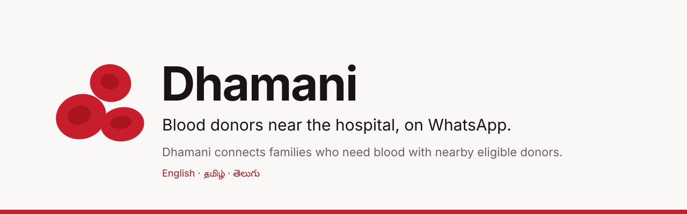
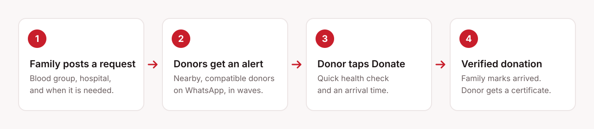
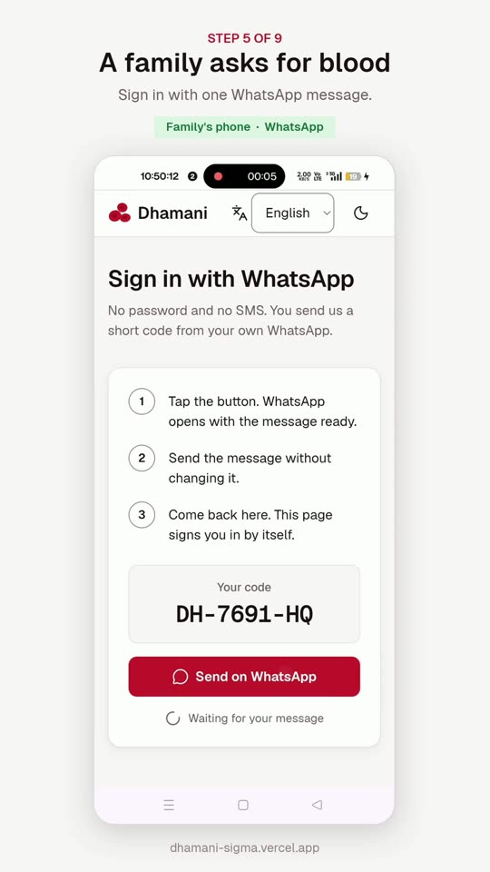
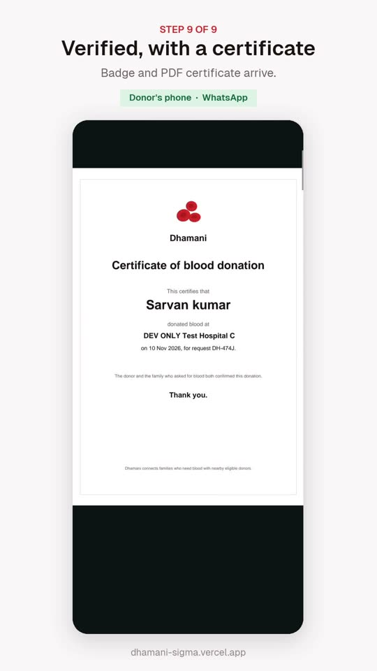

<p align="center">
  
</p>

<p align="center">
  <strong>Families ask for blood on the web. Nearby, compatible donors answer on WhatsApp.</strong><br>
  <a href="https://dhamani-sigma.vercel.app">dhamani-sigma.vercel.app</a>
</p>

---

When someone in hospital needs blood, the family usually starts calling everyone they know. Dhamani replaces that scramble with one request. It finds voluntary donors near the hospital whose blood group fits, asks them on WhatsApp, and shows the family who is coming, live.

Dhamani only pre-screens donors. It never declares anyone fit to donate; the blood centre always decides.

## Why Dhamani

- **WhatsApp first, nothing to install.** Donors sign up by sending `JOIN`, answer a few questions, and get alerts where they already chat. Families sign in by sending a short code from their own WhatsApp: no password, no SMS.
- **Only the right donors are asked.** Alerts go to donors with a compatible blood group who are near the hospital and past their donation interval, in waves, so nobody gets spammed.
- **Private by design.** Donor phone numbers are never shown to families or the public. Patients appear by first name and initial only.
- **Speaks your language.** English, Tamil and Telugu, on the web and on WhatsApp.
- **Voluntary, always.** No payments, rewards or leaderboards. Thanks come as certificates and badges.

## How it works

<p align="center">
  
</p>

<table>
  <tr>
    <td align="center" width="50%">
      <br>
      <sub>A family signs in with one WhatsApp message.</sub>
    </td>
    <td align="center" width="50%">
      <br>
      <sub>Donor and family both confirm, and the certificate arrives.</sub>
    </td>
  </tr>
</table>

## Features

- **Live request page.** The family posts a request (blood group, hospital, when it is needed) and follows it on a page that updates every few seconds: who said yes, when they expect to arrive, who has arrived.
- **Donate in three taps.** A donor taps Donate, answers a quick health check, and picks an arrival time. Answers to the check are never stored.
- **Verified donations.** A donation counts once the donor says they donated and the family marks them as arrived.
- **Certificates and Lifegiver badges.** Each verified donation earns a PDF certificate and badges, on the donor's private page (a 24 hour link sent on WhatsApp).
- **Invite links.** Every donor has a code and a `JOIN` link to share. A referral counts when the new donor completes a verified donation. Recognition only, never cash, vouchers or gifts.
- **Coordinator console.** Queues of open requests, request detail, message log, a simulation mode for demos, and top referrers per city. Coordinators never see a donor list or donor phone numbers, and every action is audited.
- **Reminders that respect people.** Requests close themselves when they expire. Donors hear "you can donate again" only once their interval has passed.
- **Installable.** Works as a PWA on any phone.

## Tech stack

| Area | Choice |
| --- | --- |
| App | Next.js 15 App Router, React 19, TypeScript strict |
| UI | Tailwind v4, shadcn/ui, lucide-react |
| Languages | next-intl (English, Tamil, Telugu), time zone Asia/Kolkata |
| Data | Neon Postgres with PostGIS, `@neondatabase/serverless`, row level security |
| Messaging | WhatsApp Cloud API through a single adapter |
| Certificates | pdf-lib |
| Slip OCR | tesseract.js, in the browser |
| Validation and tests | zod, Vitest |
| Hosting | Vercel (functions in `sin1`, next to the database), cron-job.org for scheduled jobs |

Hospitals come from the Government of India Blood Bank Directory on data.gov.in (Andhra Pradesh, Telangana, Tamil Nadu, Kerala, Karnataka). See `db/seed/hospitals.SOURCE.md`.

## Run locally

Needs Node 22 or newer.

```bash
npm install
cp .env.example .env.local   # then fill in values
npm run db:migrate
npm run db:seed
npm run dev                   # http://localhost:3000
```

Environment variables (server side only; never use the `NEXT_PUBLIC_` prefix for secrets):

| Variable | Purpose |
| --- | --- |
| `DATABASE_URL` | Neon pooled connection string |
| `APP_BASE_URL` | Public base URL for links and metadata |
| `SESSION_SECRET` | Signs session cookies and donor page tokens |
| `CRON_SECRET` | Bearer token for the cron routes |
| `WA_PHONE_NUMBER_ID`, `WA_ACCESS_TOKEN`, `WA_APP_SECRET`, `WA_VERIFY_TOKEN`, `WA_BUSINESS_NUMBER` | WhatsApp Cloud API |
| `WA_ALLOWLIST` | Numbers allowed to receive messages (max 5; empty means nobody) |
| `WA_GRAPH_VERSION` | Graph API version, default `v23.0` |
| `SIMULATION_MODE` | `true` enables the console simulation page |
| `COORDINATOR_EMAILS`, `SUPER_ADMIN_EMAILS` | Console accounts created by the seed |
| `DATA_GOV_IN_API_KEY` | Only for `db:import-hospitals` |

## Scripts

| Script | What it does |
| --- | --- |
| `npm run dev` | Dev server |
| `npm run build` | Production build, then a check that no secrets reach the client bundle |
| `npm start` | Serve the build |
| `npm run lint` / `npm run typecheck` | ESLint / `tsc --noEmit` |
| `npm test` | Unit tests |
| `npm run test:db` | Database and RLS tests against the real database |
| `npm run db:migrate` | Apply new SQL migrations |
| `npm run db:reset -- --yes` | Drop everything and re-migrate. Destructive. |
| `npm run db:seed` | Seed hospitals and console accounts |
| `npm run db:import-hospitals` | Regenerate `db/seed/hospitals.csv` from data.gov.in |
| `npm run templates:md` | Regenerate `TEMPLATES.md` from the WhatsApp copy |

## Testing

```bash
npm run lint && npm run typecheck && npm test && npm run build
```

`npm run test:db` uses synthetic numbers starting `910000000`. Tests share the database with the live app, so the live cron can occasionally pick up a row a test created.

## Scheduled jobs

cron-job.org calls both routes with `Authorization: Bearer <CRON_SECRET>`.

| Route | When | What it does |
| --- | --- | --- |
| `GET /api/cron/tick` | Every minute | Closes expired or unanswered requests, runs donor waves, sends "still needed?" pings and follow-ups |
| `GET /api/cron/daily` | 03:00 IST | Deletes slips and stale data on schedule, then tells donors when they can donate again |

## Deploy

```bash
vercel deploy --prod --yes
```

Run from `web_app`. Set production variables with `vercel env add <NAME> production`. `.vercelignore` keeps `.env*` out of uploads.

## Safety and privacy

- Pre-screening only. The blood centre makes the final call.
- Never collects Aadhaar, HIV status, sexual orientation or sexual history. Health check answers are not stored.
- Donor phone numbers are never shown to families or the public, and are masked to the last 4 digits in logs.
- Every WhatsApp send goes through one adapter that refuses any number outside the allowlist. Webhook signatures are checked, and profile names are never stored.
- Slips and closed request details are deleted on a fixed schedule.
- Naming a donor publicly needs their own "yes" on WhatsApp.
- Coordinator accounts come only from the seed. Sessions expire after 12 hours, and repeated failed logins lock the account.
